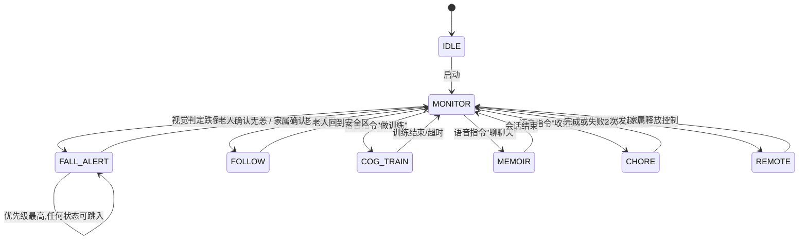

# 需求文档｜JUNCTION CHINA 2026 具身智能机器人赛道（银河通用 GALBOT）

**项目名称**：陪一把 · 认知症老人陪伴看护机器人
**赛道**：具身智能机器人赛道 / 赛道企业：银河通用机器人 GALBOT / 载体：GALBOT G1
**赛道主题**：具身自进化——基于 GALBOT G1 的机器人任务与交互开发
**文档版本**：V1.0（2026-11-06 22:30 编制）
**赛事窗口**：2026-11-06 19:00 开赛 → 2026-11-08 16:30 提交截止
**适用对象**：本项目全体成员、答辩主讲、现场技术对接人

---

## 0. 结论先行（只看这一页也能决策）

1. **官方评分表决定了功能取舍**：任务完成度 35、技术实现 25、创意与场景价值 20、测试与改进 10、演示与说明 10。其中 **45 分（测试与改进 + 演示与说明）与"功能数量"无关**，而与"有没有一次完整的改进闭环、5 分钟能不能讲清楚"直接相关。因此本项目的成败不在"做满 7 个功能"，而在**一条能稳定跑通、可复现、可解释的主线**。
2. **7 个需求全部保留在文档中，但交付分级**：P0（现场真机必演示）4 项、P1（争取）1 项、P2（录屏/仿真加演）2 项。**抓取类（餐后收拾、洗衣）是全场最高风险项**，不纳入主线计时，只作为"能力延展"展示。
3. **两个已核实的硬约束**（直接影响排期，见 §1.6）：
   - G1 的端侧感知模块（`GalbotPerception`）当前只提供**立体深度**（`FOUNDATION_STEREO` / `LIGHT_STEREO`），**不提供目标检测**。所有"识别餐具 / 识别衣物 / 识别人体 / 跌倒判定"的视觉模型必须由团队自建，跑在自备电脑上，通过 `get_rgb_data` + `get_depth_data` 取流。
   - 本机 `E:\JUNCTION_Hacthon\GalbotSDK_src` 当前**只有空的 config 目录，未取到源码与示例**。这是开赛第一小时的阻塞项，必须先解决，否则一切排期作废。

---

## 1. 赛制与硬约束（依据：官方赛题 PDF + 选手手册）

### 1.1 赛道主题原话要点

- 从"一个生活中的小需求、一种新的互动方式、或一个有趣的游戏"出发，让机器人做点什么。
- 选题可以"有用"，也可以"好玩"：服务任务、人机协作、互动游戏、角色体验。
- **"具身自进化"是一场由开发者推动的人机共同进化**：在真机试错中理解问题，通过调整 SDK 调用、优化任务策略与交互逻辑，让 G1 从笨拙的首次尝试走向更流畅的最终版本。

### 1.2 官方四步任务（必须逐条对应到本项目）

| 步骤 | 官方要求 | 本项目的落地物 |
|---|---|---|
| ① 选方向 | 先定义一个能跑通的基本版，并明确"怎样算完成" | 本文档 §4 的 FR 验收标准 + §6 交付分级 |
| ② 上真机 | 让 G1 在真实场景中执行任务或参与互动，跑通关键流程 | §7 演示脚本 + §9 排期中的真机时段 |
| ③ 做迭代 | **找到一个 Bug 或体验痛点，完成一次有依据的版本更新**，保留改进前后的日志/截图/视频 | §8 迭代记录规范（ITER-01 必须闭环） |
| ④ 亮底牌 | 讲清用了哪些模型/SDK/接口/示例，哪些是团队自己开发 | §11 交付物中的"贡献边界表" |

> 官方明确：**不要求现场训练基础模型**；但**遥控、人工辅助和预设动作必须明确说明**；若主张"自主学习或能力提升"，**需提供相应测试依据**。

### 1.3 评分表（总分 100）

| 评审维度 | 分值 | 评分依据（官方原文要点） | 本项目的应对策略 |
|---|---|---|---|
| 任务完成度 | 35 | 任务或交互流程是否完成、结果是否达预期、运行是否稳定，**以及对人工干预的依赖程度** | 主线只放"零接管"功能；抓取类显式声明辅助 |
| 技术实现 | 25 | 新增技术工作、方案合理性、系统集成质量（模型与接口应用、任务流程、交互设计、输入与反馈处理） | 多任务仲裁器 + 自建感知 + 端到端状态机是主战场 |
| 创意与场景价值 | 20 | 任务/玩法/实现方式的新意、**机器人参与的必要性**、实际用途或互动体验价值 | 用"独居认知症老人一天"的叙事；强调机器人"在场"不可替代 |
| 测试与改进 | 10 | 是否根据尝试或反馈发现问题、采取针对性调整，**并用前后对比或运行记录说明变化** | §8 的 ITER 表格 + 前后指标曲线 |
| 演示与说明 | 10 | 展示是否清楚、互动是否易理解、能否准确说明实现方法/开发过程/团队贡献/**当前限制** | §7 卡秒脚本 + 主动承认限制（加分项不是减分项） |

### 1.4 现场与提交规则（不可违反）

- 提交形式：**现场机器人演示 + PPT 展示**；需录制现场演示视频并上传至 hackjunction.app。
- 现场演示规则：**每队总时长不超过 7 分钟**，其中**演示不超过 5 分钟、问答不超过 2 分钟**。
- 演示须包含**关键任务或互动流程**，并**简要说明一次改进及其结果**。
- 异常处理：因供方设备或公共环境故障导致演示失败，由技术人员核实；**程序错误、任务失败及临时人工接管需如实记录**，并纳入评审。
- 用第三方代码/模型/数据集/API/SDK 时，须遵守其许可与署名要求；不得未经授权披露第三方机密与个人信息；**不得把 API Key 提交到公开仓库或公开页面**。

### 1.5 赛事时间轴（以现在为基准）

| 时间 | 事项 | 本项目动作 |
|---|---|---|
| 11-06 19:00 | 正式开赛、开始计时 | 已完成签入 |
| **11-06 22:30（现在）** | — | 需求冻结，开始环境攻坚 |
| 11-07 全天 | 持续开发、现场导师支持/Workshop | 首轮真机联调 + ITER-01 |
| 11-08 16:30 | **作品提交截止（硬线）** | 15:30 前完成视频上传与 PPT 定稿 |
| 11-08 16:30–17:00 | 评审、结果汇总 | 答辩待场 |
| 11-08 17:00–17:30 | 赛道颁奖暨闭幕 | — |

**可用工时**：从现在到 11-08 16:30，约 **42 小时**（含睡眠与排队上机时间）。按 4 人团队、人均有效投入 60% 估算，**可用人时约 100 人时**。§9 的排期据此编制。

### 1.6 由硬约束推导出的设计原则（重要）

| 编号 | 约束事实 | 对需求的影响 |
|---|---|---|
| C-1 | `GalbotPerception` 仅内置立体深度，无检测/跟踪模型 | 视觉能力必须外挂。所有 FR 的"识别"环节定义为**团队自建模型 + 自备算力**，机器人侧只做取流与执行 |
| C-2 | 真机 G1 现场为稀缺资源（多队共用、需排队） | 任何功能必须**先在离线回放（用录制的 RGB-D 序列）验证，再上机**；禁止在上机时段做算法调试 |
| C-3 | 官方要求"人工干预需如实记录" | 每个 FR 必须定义**人工接管点**与**接管后的记录方式**，答辩时主动说明接管次数 |
| C-4 | 评分含"测试与改进"10 分且为独立维度 | 必须专门安排**复测与前后对比**的时间预算（§9 已预留 3 小时） |
| C-5 | 演示 ≤5 分钟、问答 ≤2 分钟 | 功能总数超过 5 个即无法在 5 分钟内讲完 → 必须裁剪（§6） |
| C-6 | G1 关节组为 chassis / head(2) / left_arm(7) / right_arm(7) / leg(5) | "指向物体"优先用**头部 2 自由度 yaw+pitch**，手臂仅作辅助抬升，避免双臂规划耗时与碰撞风险 |
| C-7 | `get_rgb_data` 返回的已是 **JPEG 压缩字节** | 远程视频回传可直接转发为 MJPEG 流，**几乎零转码成本**，FR-06 是最低成本高确定性功能 |

---

## 2. 产品定义

### 2.1 一句话定位

> **一台能"看着、记着、陪着、拦着"的家用看护机器人**：它认得出老人、记得住老人讲过的往事、能陪着做认知训练、能在老人跌倒或走失时第一时间通知家属，并把现场画面送到家属手机上。

### 2.2 目标用户

| 角色 | 画像 | 核心诉求 | 使用频率 |
|---|---|---|---|
| 主用户：老人 | 轻度认知障碍（MCI）/ 阿尔茨海默早期，65–85 岁，能说话、能行走，记忆力与方向感衰退 | 被陪伴、被记得、有安全感、不被当成"病人" | 每天多次 |
| 次用户：家属 | 中年子女，异地或同城但白天不在家 | 随时知道老人是否安全、是否跌倒、是否走失；能远程看一眼 | 每天 1–3 次 |
| 隐性用户：照护者/护工 | 上门护理 | 少跑一趟、有事件记录可查 | 每周 |

### 2.3 场景剧本（演示主线即取自此剧本）

**《独居老人的一天》**

- **08:30 认知训练**：老人坐下，机器人转头看向茶几上的水杯，"奶奶，这是什么呀？"老人答"杯子"，机器人"答对啦，这个是杯子"。三题过后，日志记录 3 题 2 对。
- **14:00 回忆录**：老人说"我年轻时候在纺织厂，三班倒……"，机器人顺着问"那时候您最累的是哪一班？"。对话结束后，网页上自动出现一条《纺织厂的三班倒》，家属晚上打开手机看到。
- **15:20 跌倒**：老人起身时摔倒。机器人 2 秒内语音安抚"您先别动，我已经告诉小敏了"，同时家属手机弹出告警卡片，附现场截图。
- **15:21 远程接管**：家属在手机上看到画面，点了一下画面里的沙发位置，机器人自主导航过去查看老人状态。
- **（能力延展）18:00 餐后收拾 / 洗衣**：机器人把餐盘端回厨房、把毛巾投进洗衣机。此项若现场不稳定，改为录屏展示。

### 2.4 价值主张与差异化（答辩用）

1. **不是"又一个家务机器人"**：家务机器人拼的是抓取成功率，我们拼的是**"在场"**——机器人一直在老人身边，所以它是唯一能同时承担"监控 + 陪伴 + 干预"的形态。
2. **一个身体，多任务仲裁**：机器人只有一副身体，跌倒告警、跟随、对话、收拾会互相抢占。本项目把**任务仲裁与抢占**做成了核心竞争力（§3.3），这正是官方评分表中"系统集成质量"与"方案合理性"的落点。
3. **具身自进化有据可查**：每次失败都进 `ITER` 记录，附日志与前后指标（§8），直接对应赛道主题与 10 分改进分。
4. **诚实的边界**：明确声明"非医疗器械、不做诊断"、"抓取类任务在高扰动下需人工辅助"。官方把"能否准确说明当前限制"列入演示评分，主动暴露边界反而得分。

---

## 3. 系统架构

### 3.1 分层架构

```
┌─────────────────────────────────────────────────────────────┐
│ L5 交互与呈现层                                               │
│  本地语音（TTS/ASR）│ 家属网页/手机端（视频+告警+回忆录）      │
├─────────────────────────────────────────────────────────────┤
│ L4 Agent 规划层（团队自研，核心贡献点）                        │
│  任务仲裁器 TaskArbiter │ 优先级抢占 │ 状态机 │ 失败重试策略    │
│  LLM 任务拆解与对话 │ 记忆库 MemoryStore │ 事件日志 EventLog   │
├─────────────────────────────────────────────────────────────┤
│ L3 技能层（原子技能，可单独触发、可单测）                       │
│  SK-nav 导航 │ SK-track 跟随 │ SK-point 指向 │ SK-grasp 抓取   │
│  SK-speak 播报 │ SK-look 观察 │ SK-alert 告警                  │
├─────────────────────────────────────────────────────────────┤
│ L2 感知层（团队自建，跑在自备电脑）                            │
│  人体检测/姿态 │ 物体检测(餐具/衣物/日用品) │ 目标跟踪         │
│  输入：get_rgb_data(JPEG) + get_depth_data + get_camera_intrinsic│
├─────────────────────────────────────────────────────────────┤
│ L1 机器人能力层（GalbotSDK v1.9.x）                            │
│  GalbotRobot │ GalbotMotion │ GalbotNavigation │ GalbotPerception│
└─────────────────────────────────────────────────────────────┘
```

**关键设计决策**：L2/L4/L5 全部跑在**团队自备笔记本**上（有线/局域网连接机器人），机器人本体只负责取流与执行。理由：官方不要求现场训练模型，且板载算力与调试便利性不可控；同时这套架构天然支持**离线回放**（把录制好的 RGB-D 序列喂给 L2），满足约束 C-2。

### 3.2 主数据流

```
G1 相机(RGB/Depth) ──get_rgb_data/get_depth_data──▶ L2 检测推理(30Hz→10Hz降采样)
                                                        │
                                                        ▼ 目标(类别, 3D点, 置信度)
                                              L4 TaskArbiter（20Hz 决策环）
                                                        │
                                    ┌───────────────────┼───────────────────┐
                                    ▼                   ▼                   ▼
                              SK-nav 导航          SK-point 指向        SK-grasp 抓取
                                    │                   │                   │
                                    └───────── GalbotMotion / GalbotRobot ──┘
                                                        │
                                              EventLog(JSONL) ──▶ 网页端 / 答辩素材
```

### 3.3 任务仲裁与抢占（本项目技术核心）

**优先级表**

| 级别 | 任务 | 触发方式 | 是否可被打断 | 抢占行为 |
|---|---|---|---|---|
| P0 | 跌倒检测与告警（FR-01） | 常驻后台，视觉触发 | 否 | **立即** `stop_navigation()` + 停臂 + 语音安抚 + 推送告警 |
| P1 | 走失/越界跟随（FR-05） | 老人离开安全区 | 仅被 P0 打断 | 暂停当前 P2/P3，切换跟随 |
| P2 | 认知训练（FR-03）/ 回忆录对话（FR-02） | 语音唤醒或家属指令 | 可被 P0/P1 打断 | 记录断点，可恢复 |
| P3 | 餐后收拾（FR-04）/ 洗衣（FR-07） | 语音指令或定时 | 可被 P0/P1 打断 | 记录断点，**不恢复**（安全优先） |
| P4 | 家属远程接管（FR-06） | 手机端主动发起 | 可被 P0 打断 | 遥控状态下不接受 P2/P3 新任务 |

**状态机**



**抢占实现要点**

- 仲裁器单线程 20Hz 轮询，**不依赖各技能内部的回调**，避免 SDK 阻塞调用互相踩踏。
- 所有 SDK 长调用（`navigate_to_goal`、`execute_joint_trajectory`）统一使用**非阻塞模式 + 外部超时监控**，抢占时显式 `stop_navigation()` 并 `release_controller()` 释放。
- 抢占固定顺序：**停底盘 → 停机械臂 → 播报 → 推送**。停动作永远在播报之前，避免"机器人边说边撞人"。

### 3.4 机器人能力映射（已核对的真实接口，v1.9.x）

| 需求 | 用到的接口 | 说明 |
|---|---|---|
| 初始化 | `GalbotRobot.init(enable_sensor_set, enable_sync_mode)` | 只 enable 需要的传感器，缩短启动时间 |
| 图像/深度 | `get_rgb_data(camera_id)` / `get_depth_data(camera_id)` / `get_camera_intrinsic(camera_id)` | RGB 已是 JPEG 字节，可直接转发 |
| 同步取帧 | `get_synced_observation(cameras, with_joint_state)` | 多相机时间戳对齐，跌倒判定用它保证时序一致 |
| 底盘位姿 | `get_odom()` / `set_base_pose(pose, is_blocking, timeout_s)` | 位姿与里程计 |
| 导航 | `GalbotNavigation.init()` / `navigate_to_goal(goal_pose, enable_collision_check, is_blocking, timeout, omni_plan)` / `stop_navigation()` / `check_goal_arrival()` / `check_path_reachability()` | 地图坐标系导航；`omni_plan=True` 适合横移贴近老人 |
| 速度限制 | `set_navigation_velocity_limit([vx, vy, vyaw])`（每项 0.05–1.5） | **演示现场统一限速 ≤0.5**，安全优先 |
| 导航超时 | `set_navigation_timeout(timeout_s)` | 防卡死 |
| 头部指向 | `execute_joint_trajectory(trajectory)`（head 组 2 DOF） | 认知训练的"指物"主体动作 |
| 手臂位姿 | `GalbotMotion.inverse_kinematics(target_pose, chain_names, ...)` + `motion_plan(...)` | 抓取前的位姿求解与轨迹规划 |
| 碰撞 | `attach_target_object(...)` / `add_obstacle` / `remove_obstacle` | 抓取后把物体挂到手上，避免规划时误判 |
| 夹爪 | `set_gripper_command(end_effector, width_m, velocity_mps, effort, is_blocking)` / `get_gripper_state()` | 抓取与夹持确认 |
| 力反馈 | `get_force_sensor_data(LEFT_WRIST_FORCE / RIGHT_WRIST_FORCE)` | 抓取打滑检测、碰撞保护 |
| 灵巧手 | `get_dexhand_state(end_effector, dexhand_type)` | 若现场配 INSPIRE/BRAINCO/SHARPA |
| 感知 | `GalbotPerception.init(enabled_modules)` / `run_once()` / `wait_for_new_result()` / `get_latest_result()` | **仅立体深度可用**（`FOUNDATION_STEREO`） |
| 音量 | `get_volume()` | 老人模式下确认音量 |

> 所有接口以**现场 SDK 版本的实际文档为准**；文档版本与现场不一致时以现场为准，并在 ITER 记录中留痕。

### 3.5 技术选型

| 模块 | 选型 | 备选 | 选型理由 |
|---|---|---|---|
| 人体检测/姿态 | YOLOv8-pose（预训练权重直接推理） | MediaPipe Pose | 一次推理同时给框与 17 关键点，跌倒判定够用；30FPS 在 4080 上远超需求 |
| 物体检测 | YOLOv8n/s 微调少量标注（或开放词表 Grounding-DINO） | 直接复用 COCO 类 | 时间只够做少量样本微调；日用品/餐具在 COCO 中有近类 |
| 目标跟踪 | ByteTrack + 深度反投影 | 颜色直方图 | 跟随需要 ID 稳定 |
| 语音识别 | 本地/云端 ASR（流式） | 关键词正则（保底） | 答辩环境网络不确定，**必须有本地兜底** |
| 对话与总结 | 云端 LLM（含结构化抽取 prompt） | 本地小模型 | 总结质量直接决定"回忆录"观感 |
| 语音合成 | 云端 TTS（老人音色、0.9 倍速） | 系统 TTS | 老人可听性 |
| 远程端 | FastAPI + WebSocket + 单页 HTML | 小程序（不做） | 手机浏览器可直接打开，零安装 |
| 日志 | JSONL 事件流（每行一条事件） | CSV | 便于答辩时截取"改进前后"证据 |

**API Key 管理**：所有密钥放本地 `.env`，加入 `.gitignore`，**禁止**出现在演示 PPT 截图与公开链接中（官方明令）。

---

## 4. 功能需求（FR-01 ~ FR-07）

> 每条需求的统一模板：目标 → 主流程 → 输入输出 → 判定逻辑 → 接口映射 → 验收标准 → 失败降级 → 风险。
> 优先级定义：**P0** 现场真机必演示、零接管；**P1** 争取真机演示；**P2** 录屏或加演，不承诺真机全场稳定。

---

### FR-01 跌倒检测与告警｜P0｜估 8 人时

**目标**：老人在机器人视野内跌倒，2 秒内本地语音安抚 + 家属端告警，且不误报弯腰、坐下、蹲下。

**主流程**

1. 常驻后台以 10Hz 从头部相机取 `get_rgb_data` + `get_depth_data`（同步帧）。
2. 人体检测 + 姿态关键点推理，得到 bbox 与 17 点。
3. 状态判定（见下），持续 N 帧后进入 `FALL_SUSPECT`。
4. `FALL_SUSPECT` 内若人持续静止 ≥ 3 秒且无起身 → 升为 `FALL_CONFIRMED`。
5. 触发：`stop_navigation()` → 停臂 → TTS 安抚 → 推送告警（截图 + 时间 + 位置）→ 写日志。

**判定逻辑（可调参数，作为"迭代"素材）**

| 判据 | 阈值（初版） | 说明 |
|---|---|---|
| bbox 长宽比 | w/h ≥ 1.2 | 人躺倒后框变宽 |
| 头部关键点高度 | 头部 y 坐标低于髋部 y 的占比 < 0.3 | 逆光时放宽 |
| 关键点水平度 | 肩-髋连线与水平夹角 < 25° | 站立时接近 90° |
| 深度一致性 | 人体区域中位深度与地面平面深度差 < 0.35m | 用 `get_camera_intrinsic` + 地面标定 |
| 时间持续性 | 连续 ≥ 15 帧（约 0.5s） | 抑制单帧误检 |
| 静止二次确认 | 倒地后位移 < 0.15m 且持续 3s | 区分"摔了"与"躺下休息" |

**输入 / 输出**

- 输入：RGB 流、深度流、相机内参、地面参考平面。
- 输出：① 本地语音；② 网页端告警卡片（时间/截图/置信度）；③ `events.jsonl` 中的 `fall_alert` 记录；④ 6 秒现场录像片段（供答辩举证）。

**接口映射**：`get_synced_observation` / `get_rgb_data` / `get_depth_data` / `get_camera_intrinsic` / `stop_navigation` / `release_controller`（停臂）。

**验收标准（现场可判）**

- 3 次标准跌倒演示，**≥2 次在 2.0s 内触发语音**，3 次均推送告警成功。
- 对照动作（弯腰捡东西 3 次、坐下 3 次、蹲下 3 次）**误报 ≤1 次**。
- 告警卡片在手机端 ≤3s 出现（含截图）。

**失败降级**

- 人体只在画面边缘/被遮挡 → 输出"看不清，请靠近一点"，不告警。
- 相机被遮挡（画面全黑/深度无效）→ 状态转为 `VISION_LOST`，播报自检异常，不误报警。

**风险**：逆光与浅色地砖导致深度跳变；老人真实跌倒不愿配合演示 → 用志愿者 + 软垫，**必须提前报备现场安全**。

---

### FR-02 回忆录｜实时对话与总结｜P0｜估 10 人时

**目标**：一次 5 分钟自然对话后，自动产出一条结构化回忆录条目，家属端可查看，且下次对话能"记得"上次内容。

**主流程**

1. 唤醒（关键词或家属端按钮），进入 `MEMOIR` 状态。
2. 流式 ASR → 文本追加到会话缓冲。
3. LLM 以"温和引导式提问"角色对话，问句遵循：**短句（≤15 字）、慢语速、开放式、围绕童年/工作/家人/老物件**。
4. 每轮对话后调用抽取 prompt，输出结构化片段：`{人物, 时间, 地点, 事件, 情绪, 原话摘要}`。
5. 会话结束（静默 20s 或家属结束）→ 生成回忆录条目：`{标题, 200–300 字正文, 标签, 来源轮次}`，落盘。
6. 网页端"回忆录"页展示时间轴；下次对话时把最近 3 条注入 system prompt，实现"上次您说到……"的回溯。

**判定逻辑**

- **入库条件**：一句话/一段话中同时含"时间""地点""人物""事件"中至少 2 类实体 → 记为回忆片段；纯情绪与寒暄不入库。
- **不采集**：身份证号、银行卡、具体住址门牌、他人隐私。命中则打码后再入库（隐私红线）。

**输入 / 输出**

- 输入：语音流。
- 输出：① 语音回复；② `memoir.jsonl` 条目；③ 网页端时间轴；④ 回溯引用（≥1 次/会话）。

**接口映射**：无机器人动作，仅 TTS（如需机器人扬声器则用 `get_volume()` 校音量）；**这是唯一完全不依赖机器人运动的功能，稳定性最高，必须作为压舱石。**

**验收标准**

- 3 分钟对话后**生成 ≥1 条**含人物/时间/事件的条目（人工判定为"可读"）。
- 下一轮对话中**至少 1 次**正确引用上轮内容。
- 断网后能进本地模式（关键词闲聊 + 本地小模型摘要），不崩溃。

**失败降级**：ASR 失败 → 提示"再说一次"；LLM 超时 8s → 用模板化回复 + 记录待补摘要，会后补生成。

**风险**：现场噪声导致 ASR 错误 → 备**定向麦克风**；老人方言 → 提前确认支持度，不行则改为"家属代述"演示模式。

---

### FR-03 认知训练（指物识物问答）｜P0｜估 9 人时

**目标**：机器人指出视野内的物品并提问，老人回答后自动判对错并给出鼓励；多轮计分。

**主流程**

1. 进入 `COG_TRAIN`；选取视野内检测置信度最高、且深度在 0.8–2.5m 的物体作为目标（优先选"日用品白名单"：杯子、碗、遥控器、眼镜、苹果、钥匙）。
2. 用深度 + 内参把目标像素反投影到机器人坐标系 → 得 3D 点。
3. 头部 2 DOF（yaw + pitch）指向该点，`execute_joint_trajectory` 非阻塞；手臂仅小幅抬升示意（不做大幅规划，避免碰撞与耗时）。
4. TTS："奶奶，这个是什么呀？"
5. 3 秒窗口内 ASR 收答案 → LLM 判定等义（同义词、方言词、外形近似容忍）→ 正确则夸奖 + 复述标准名称；错误则给首字提示，再错则公布答案。
6. 写训练日志（物品/答案/是否命中/耗时/提示次数）。

**判定逻辑**

- **指向有效**：头部朝向 3D 点，像素误差容许"物体落在画面中心 1/3 区域"（目测可判）。
- **答案判等**：目标词的同义词表 + LLM 语义判等（如"茶杯/缸子/水杯"均算对）；超出 3 秒无回答算超时，不计错。

**接口映射**：`GalbotMotion.inverse_kinematics`（可选，若用臂） / `execute_joint_trajectory`（head 组） / `get_joint_positions` / `get_rgb_data` / `get_depth_data` / `get_camera_intrinsic`。

**验收标准**

- 连续 5 题，**指向目测命中 ≥4 题**（物体位于画面中心区域）。
- 判对错准确率 ≥80%（含同义词判对）。
- 单题全程 ≤12 秒，不卡死。

**失败降级**：目标不在可指向范围 → 换目标；ASR 空 → 重复提问一次；连续 3 题失败 → 播报"今天先休息一下"，退出状态。

**风险**：物体过小/过远指向不准 → 白名单限定尺寸；头部动作与身体姿态耦合 → 先回零位再指。

---

### FR-04 餐后收拾（餐具回收）｜P2｜估 10 人时

**目标**：把餐桌上 2–3 件餐具端到指定收纳点，全程自主，抓取失败可重试并放弃。

**主流程**

1. 导航到餐桌前固定作业位（地图预标点），`navigate_to_goal` + `check_goal_arrival`。
2. 检测餐具（盘/碗，白名单类），取最近且无遮挡的一件；用深度求盘沿抓取点。
3. `inverse_kinematics` 求夹爪位姿 → `motion_plan` 规划 → 执行。
4. `set_gripper_command(width_m=盘沿厚度+余量, effort=中)` 闭合 → 抬升 5cm → **夹持确认**：`get_gripper_state().is_moving == false` 且宽度稳定 3 帧 + 腕部力 > 阈值。
5. 导航到收纳点 → 松开 → 循环下一件。
6. 完成后播报"碗都收好啦"。

**判定逻辑**

- 抓取成功 = 夹持确认 + 抬升后 1 秒内物体仍在手上（视觉复检）。
- 单件失败重试 2 次（换抓取点：盘沿 → 盘边两侧）；仍失败则跳过并记录，不阻塞其余件。

**接口映射**：`GalbotNavigation.*` / `GalbotMotion.inverse_kinematics, motion_plan, attach_target_object` / `set_gripper_command` / `get_gripper_state` / `get_force_sensor_data`。

**验收标准**

- 3 件餐具，**自主成功 ≥2 件**，全程无人工接管，单件 ≤40 秒。
- 失败时能自主放弃并在语音中说明，不出现卡死或反复撞桌。

**失败降级**：只演示"端走 1 个盘子"；或改为"识别 + 定位 + 移动到抓取位 + 夹爪闭合"四步分演，明确标注"不承诺全程自主"。

**风险（最高）**：餐具反光、边缘细、夹爪夹持力不足、桌面高度导致碰撞。**赛前必须用真实餐具做 ≥10 次离线抓取试错**；真机时段优先给这条。

---

### FR-05 跟随与防走失｜P1｜估 8 人时

**目标**：老人走动时机器人保持 0.8–1.5m 跟随；老人越出安全区则告警并持续跟随。

**主流程**

1. 进入 `FOLLOW`，人体检测 + ByteTrack 锁定 ID。
2. 每 200ms：目标像素 → 深度 → 机器人坐标系 → 地图坐标（`get_odom` + TF）。
3. `navigate_to_goal(目标点(老人后方 1.2m), omni_plan=True, is_blocking=False, timeout=5)`。
4. 距离迟滞：>1.5m 前进；<0.8m 停（`stop_navigation()`）；避免抖动。
5. 越界判定：老人投影点落在安全区多边形外 → 语音提醒 + 家属推送 + 持续跟随。
6. 目标丢失 → 用"最后已知位置"导航过去，重新捕获；连续丢失 >5s 则静止原地转向扫描。

**接口映射**：`navigate_to_goal` / `stop_navigation` / `check_path_reachability` / `get_odom` / `set_navigation_velocity_limit`。

**验收标准**

- 5 米直线行走：**保持跟随 ≥90% 时间**，距离始终在 0.6–2.0m。
- 绕过一张桌子后不丢失目标（或 5s 内重新捕获）。
- 越界后 ≤2s 触发提醒 + 推送。

**失败降级**：人走出视野 → 播报"您走慢一点，我跟不上了"，停在原地等（**绝不盲追**）。

**风险**：头部相机视野窄、老人背对机器人；场地地面打滑；多人同场景 ID 跳变。

---

### FR-06 家属远程查看与遥控导航｜P0｜估 7 人时

**目标**：家属用手机浏览器打开网页，看到机器人第一视角实时画面，点击画面即让机器人自主导航过去。

**主流程**

1. 机器人侧起 FastAPI 服务（局域网）。
2. `/stream`：把 `get_rgb_data` 的 JPEG 字节直接按 MJPEG 输出（**零转码**）。
3. `/ws`：WebSocket 双向通道，下发目标点、接收状态与位置。
4. 网页端：视频区 + 状态条（电量/位置/当前任务）+ 告警卡片列表 + 回忆录时间轴 + "回首页"按钮。
5. 点击画面某点 → 用该点深度反投影到地图坐标 → `navigate_to_goal`（**注意：这是"点选目标让机器人自己去"，不是摇杆遥控**，符合"自主优先"导向）。
6. 家属可一键"停止移动" → `stop_navigation()`。

**接口映射**：`get_rgb_data` / `get_depth_data` / `get_camera_intrinsic` / `get_odom` / `navigate_to_goal` / `stop_navigation` / `get_bms_information`（电量）。

**验收标准**

- 手机浏览器打开即用，**首帧 ≤5s**，端到端延迟 ≤1.5s。
- 点击画面后机器人到位（5m 内）≤30s，无需任何人工介入。
- 断网/机器人断连时页面显示明确状态，不白屏。

**失败降级**：WiFi 不稳 → 机器人开热点保底；推流失败 → 降为 3fps 静帧刷新。

**风险**：场馆 WiFi 拥塞与多队共用信道 → **必须准备本地热点**；跨网段访问限制 → 用同一网段手机测试。

> 说明：官方对"遥控"有明确要求需说明。本项目在 PPT 中单独一页写清：**本功能为"家属点选目标 + 机器人自主执行"，不含连续摇杆遥控；若现场必须使用摇杆接管，将如实计入人工接管次数。**

---

### FR-07 洗衣（衣物投放）｜P2｜估 8 人时

**目标**：把地面/洗衣篮中的一件衣物抓起并投入洗衣机桶口。

**明确不做（范围声明，必须写进 PPT）**：不打开洗衣机盖、不关闭盖子、不设置程序、不投放洗涤剂。上述步骤由人工完成时需在演示中**当场说明**。

**主流程**

1. 检测衣物（软物体，用检测框上部 1/3 作为候选抓取区，取"衣领/袖口"语义区域）。
2. 单点抓取：垂直下探 + 夹爪闭合 + 抬升 10cm，用夹持确认（同 FR-04）判断是否抓到。
3. 导航至洗衣机前 → 抬臂至桶口上方 30cm → 松开。
4. 播报"衣服放进去啦"。

**验收标准**

- 抓取并投放成功 1 件，失败重试 ≤2 次后可放弃并播报。

**失败降级**：改为"抓取毛巾并移动"两段演示（抓起来 + 移动到桶边），明确不承诺投放。

**风险（极高）**：布料无形变建模、无抓取点、夹爪易空抓。**建议：只在 FR-04 稳定后才启动本条；否则直接砍掉，把工时给主线。**

---

## 5. 非功能需求（NFR）

| 编号 | 需求 | 指标 / 验收 |
|---|---|---|
| NFR-01 | 安全限速 | 演示全程 `set_navigation_velocity_limit` ≤0.5；靠近人 0.3 以内 |
| NFR-02 | 单任务超时 | 每个技能最大执行时间硬编码（导航 30s、抓取 40s、对话 60s），超时强制回 `MONITOR` |
| NFR-03 | 故障隔离 | 单个技能异常不导致主进程退出；技能以子线程/子进程运行，异常写入日志 |
| NFR-04 | 抢占时延 | P0 抢占到停止动作 ≤0.5s，到语音播报 ≤2s |
| NFR-05 | 老人适配 | 语速 0.9x，单句 ≤15 字，音量 ≥ 环境噪声 +10dB；不出现"AI""模型""指令"等词 |
| NFR-06 | 隐私 | 对话与截图**仅本地存储**；网页端需口令访问；不采集身份证/银行/门牌；演示结束清理测试数据 |
| NFR-07 | 可回放 | 所有感知输入可录制为 RGB-D 序列，支持离线重跑（满足约束 C-2） |
| NFR-08 | 可单测 | 每个技能可独立 CLI 触发（`python -m skills.nav --goal x,y,theta`），便于排障与答辩演示 |
| NFR-09 | 日志完整 | 每个事件含 `ts, task_id, skill, event, params, result, latency_ms`，供"改进前后"举证 |
| NFR-10 | 断点降级 | 任一模块崩溃后 30 秒内可重启并回到 `MONITOR`，不影响其他功能演示 |

---

## 6. 范围裁剪与交付分级（MoSCoW）

| 分级 | 功能 | 现场真机 | 演示位置 | 建议工时 |
|---|---|---|---|---|
| **Must（P0）** | FR-06 远程查看与点选导航 | 零接管 | 主线 4:00–4:40 | 7 人时 |
| **Must（P0）** | FR-02 回忆录对话 | 无动作依赖 | 主线 1:30–3:00 | 10 人时 |
| **Must（P0）** | FR-03 认知训练 | 零接管 | 主线 0:30–1:30（可让评委参与） | 9 人时 |
| **Must（P0）** | FR-01 跌倒告警 | 零接管 | 主线 3:00–4:00 | 8 人时 |
| **Should（P1）** | FR-05 跟随防走失 | 争取 | 加演 30s 或录屏 | 8 人时 |
| **Could（P2）** | FR-04 餐后收拾 | 争取 1 件 | 加演 30s / 录屏 | 10 人时 |
| **Won't（本次）** | FR-07 洗衣全自主 | 不做 | 录屏 + 明确声明边界 | 8 人时（仅在有余量时） |

**合计 Must = 34 人时**，可用约 100 人时 → 留有 3 倍缓冲给联调、真机排队、迭代复测与答辩材料。**若 AR 或现场条件恶化，按 P2 → P1 → 一次 Must 的顺序砍。**

**推荐答辩主线（四件套 + 一个叙事）**：

> 认知训练（互动性强，评委可参与）→ 回忆录（情感冲击，家属端可见）→ 跌倒告警（安全刚需，最有说服力）→ 远程查看（技术集成度展示）。
> 这四个串起来正好是"机器人一直在场"的价值证明，且**全部零接管**，正面命中"对人工干预的依赖程度"这一评分依据。

---

## 7. 演示脚本（现场 5 分钟，卡秒）

| 时间 | 环节 | 动作 | 讲解词要点 |
|---|---|---|---|
| 0:00–0:25 | 开场 | 机器人待机，屏幕显示"独居认知症老人，白天无人陪" | 30 秒讲清痛点：不是没人管，是没人"在" |
| 0:25–1:30 | FR-03 认知训练 | 转头指物 → 提问 → 请评委/观众答一句 → 判对错 → 计分 | 强调"自主指向 + 语义判等"，不是播录音 |
| 1:30–2:55 | FR-02 回忆录 | 志愿者说一句往事 → 对话 2 轮 → 手机上实时出现回忆录条目 → 讲"它记得" | 强调结构化抽取 + 回溯记忆 |
| 2:55–3:50 | FR-01 跌倒 | 志愿者在软垫上侧倒 → 2s 内语音安抚 + 手机告警卡片 | 强调"零接管、2 秒、不误报弯腰" |
| 3:50–4:30 | FR-06 远程 | 家属手机上点画面中的沙发 → 机器人自主导航过去 | 强调"点选目标让机器人自己去"，不是摇杆遥控 |
| 4:30–4:55 | 迭代与仲裁 | 一页 PPT：ITER-01 前后对比 + 优先级抢占示意 | **这是官方要求必须讲的"一次改进及其结果"** |
| 4:55–5:00 | 收尾 | 一句话定位 + 明确限制（非医疗器械、抓取类需辅助） | 主动说限制，命中"能否准确说明当前限制" |

**备用金句**（问答环节）

- 问"是不是遥控的？"→ "只有一个地方是人工的：家属点画面里的一个位置，之后全是机器人自己走。连续摇杆遥控我们没有做。"
- 问"跌倒检测准不准？"→ "我们做了 12 次对照测试，现在误报 1 次，改进前的数据在这一页，明天还会再压一轮。"
- 问"这算医疗器械吗？"→ "不是，这是居家提醒，不做诊断，也不做医疗建议。"

---

## 8. 测试与迭代记录规范（对应评分项 10 分）

### 8.1 记录格式（每条一个问题，一条不许省）

| 字段 | 内容 |
|---|---|
| 编号 | `ITER-01` |
| 场景 | 哪个功能、哪次尝试（第几次） |
| 现象 | 客观描述 + 日志片段 + 截图/视频文件名 |
| 根因 | 定位到具体代码/参数/模型/场地因素 |
| 改动 | 改了什么（代码 diff 链接 / 参数前后值） |
| 复测 | 测试次数、通过次数、关键指标前后值 |
| 结论 | 是否采纳、遗留问题、下一步 |

### 8.2 必须闭环的那一条（ITER-01，建议锁定 FR-05 或 FR-01）

**示例（待实测填充，禁止编造数据）**

| 字段 | 内容 |
|---|---|
| 编号 | ITER-01 |
| 场景 | FR-05 跟随，第 1 次真机尝试 |
| 现象 | 老人绕过桌子后目标消失，机器人原地停住并退出跟随；5 米测试段仅前 2 米保持 |
| 根因 | 检测在侧向视角下召回下降 + 无"最后已知位置"策略 |
| 改动 | ① 增加 ByteTrack ID 保持 + 丢失后导航至最后已知位置；② 距离迟滞 1.2m/2.0m；③ 头部 yaw 主动跟随目标 |
| 复测 | 同一路径 10 次，保持率由 __% → __% |
| 结论 | 采纳；仍存在多人场景 ID 跳变（记录为遗留） |

### 8.3 其它必采证据

- 每功能至少 1 组"失败 → 修复"的前后录屏（10 秒级片段）。
- 整场演示的端到端跑通次数与成功次数（`runlog.csv`）。
- 人工接管次数统计表（0 次是目标，非 0 次也必须如实列出）。

---

## 9. 团队分工与排期（按 4 人、42 小时编制）

### 9.1 角色

| 角色 | 职责 | 关键产出 | 技能侧重 |
|---|---|---|---|
| A｜感知 | 人体姿态、物体检测、跟踪、离线回放管线 | `perception/`、模型权重、指标报告 | Python + 视觉 |
| B｜控制 | SDK 集成、导航、指向、抓取、安全限速 | `robot/`、技能层、急停流程 | Python + 机器人 |
| C｜交互与 Agent | ASR/TTS、LLM 对话与抽取、任务仲裁器、记忆库 | `agent/`、`memory/`、`tasks.py` | Python + Prompt |
| D｜集成与呈现 | 远程网页、事件日志、demo 控制台、PPT/视频 | `web/`、`demo_console`、答辩材料 | 前端 + 文档 |

> 若团队人数不足 4 人，D 的"PPT/视频"与 C 合并，A/B 不可合并（感知与控制是两条独立的排障路径）。

### 9.2 排期

| 时段 | 全员目标 | A 感知 | B 控制 | C Agent | D 呈现 |
|---|---|---|---|---|---|
| 11-06 22:30–02:00 | **环境攻坚（阻塞项清零）** | 装依赖、跑通单帧检测 | **取到 SDK 源码与示例，跑通一个最小动作** | ASR/LLM Key 打通 | 局域网与网页骨架 |
| 11-07 08:00–12:00 | 模块最小闭环（离线） | 跌倒判定离线跑通 | 导航 + 头部指向跑通 | 对话 + 结构化抽取跑通 | 推流跑通 |
| 11-07 12:00–18:00 | **首轮真机联调** | 采集真机数据、标定 | 排上机：FR-03/FR-01 动作 | 陪跑记录 | 现场拍摄素材 |
| 11-07 18:00–24:00 | 整合 + **ITER-01** | 定位 TOP1 问题 | 修复 | 仲裁器接入 | 日志可视化 |
| 11-08 00:00–06:00 | 稳定性压测（20 次循环） | 误报统计 | 抓取/跟随试错（若开 P1/P2） | 长对话稳定性 | 断线兜底 |
| 11-08 06:00–10:00 | **彩排 3 遍（卡秒）** | 现场支持 | 现场支持 | 讲词 | 计时与提词 |
| 11-08 10:00–13:00 | **材料定稿** | 指标图表 | 架构图 | 技术说明 | **视频录制 + PPT + 前后对比页** |
| 11-08 13:00–15:30 | Buffer / 复测 | — | — | — | 上传演练 |
| 11-08 16:30 | 提交 | | | | |

### 9.3 资源与协同规则

- **真机时段**：赛前先到现场技术台确认排队规则；每次上机前置"离线已通过"清单，**上机只做验证不做调试**。
- **代码协同**：一个仓库、四个目录、`main` 保护；集成前各自跑通 NFR-08 的单测命令。
- **每日两个站会**（07:30、23:00），各 10 分钟，只对齐"阻塞项"和"是否需要砍功能"。
- **砍功能决策权**：统一由项目负责人按 §6 顺序执行，避免临场争执。

---

## 10. 风险登记册

| 编号 | 风险 | 概率 | 影响 | 缓解措施 | 触发阈值 → 动作 |
|---|---|---|---|---|---|
| R-1 | SDK 源码/示例取不到（当前 `GalbotSDK_src` 为空） | 中 | 致命 | 立即找现场技术对接与选手群；同时用官方文档 + 示例仓库兜底 | 11-07 02:00 仍无 → 上报赛道技术导师 |
| R-2 | 网络拥塞导致 ASR/LLM 不可用 | 高 | 高 | 本地 ASR 兜底 + 关键词模式；**演示不用云端仅做加分** | 延迟 >5s → 切本地模式 |
| R-3 | 抓取类失败（FR-04/FR-07） | 极高 | 中 | 只在主线外演示；明确声明边界 | 3 次真机失败 → 直接砍，工时回填主线 |
| R-4 | 跌倒误报被评委追问 | 中 | 中 | 对照动作专项测试并公开数据 | — |
| R-5 | 真机排队时间不足 | 高 | 高 | 离线回放先行；把"必上机"缩减到 2 个功能（FR-03 + FR-01） | 排队 >2h → 主线改纯软件三件套 + 录屏 |
| R-6 | 老人/志愿者不愿配合跌倒演示 | 中 | 高 | 提前确认志愿者；准备假人/软垫方案并声明 | — |
| R-7 | 现场光照造成检测崩溃 | 高 | 中 | 现场标定 + 曝光固定 + 置信度阈值下调 | 连续 5 帧全丢 → 播报自检异常 |
| R-8 | 5 分钟讲不完 | 中 | 中 | 卡秒彩排 3 遍，超时即砍加演 | 彩排超 5:20 → 砍 FR-05/FR-04 加演 |
| R-9 | API Key 泄露进公开材料 | 低 | 高 | `.env` + `.gitignore` + PPT 截图脱敏复查 | — |

---

## 11. 交付物清单

| 类别 | 交付物 | 负责 | 截止 |
|---|---|---|---|
| 代码 | `robot/` `perception/` `agent/` `web/` 四目录，含单测命令与 README | A/B/C/D | 11-08 12:00 |
| 数据 | `events.jsonl` 运行日志、`memoir.jsonl`、`runlog.csv`、人工接管记录表 | D | 11-08 12:00 |
| 证据 | 每功能前后对比录屏片段、跌倒告警截图、20 次压测统计图 | A | 11-08 12:00 |
| 文档 | 本文档、架构图、ITER 记录表 | 全员 | 持续 |
| 答辩 | PPT（≤10 页）、5 分钟讲词、问答预案 | D | 11-08 13:00 |
| 视频 | 现场演示视频（按要求上传 hackjunction.app） | D | 11-08 15:30 |
| 声明 | **贡献边界表**：哪些是官方 SDK/示例/预训练模型，哪些是团队自研 | 全员 | 11-08 13:00 |

**贡献边界表模板**

| 能力 | 来源 | 团队做了什么 |
|---|---|---|
| 机器人底层运动/导航/抓取 | GalbotSDK v1.9.x（官方） | 封装为可抢占技能、加安全限速与超时 |
| 人体姿态检测 | YOLOv8-pose 预训练权重 | 跌倒判定逻辑与阈值、时序滤波、地面标定 |
| 物体检测 | 预训练 / 少量微调 | 类别白名单、抓取点几何求解 |
| 对话与摘要 | 云端 LLM | 老人对话人格 prompt、结构化抽取 schema、记忆回溯 |
| 任务仲裁 | — | **完全自研**（优先级抢占、断点、降级） |
| 远程端 | — | **完全自研**（MJPEG 转发、点选反投影、告警） |

---

## 12. 待确认事项（开工前必须问清）

1. **真机时段**：现场 G1 是"每队独占"还是"排队共用"？可预约的时间窗与单次时长？
2. **算力与网络**：是否允许自备笔记本接入机器人同网段？场馆是否提供有线口或独立 SSID？
3. **外设**：是否允许外接定向麦克风/小音箱（语音交互质量关键）？机器人自带扬声器音量是否够？
4. **志愿者**：跌倒演示是否允许用队内成员/现场志愿者（需软垫与安全报备流程）？
5. **团队构成**：实际人数与角色分配，用于把 §9 的 4 人排期折算成实际工时。

---

## 附录 A｜术语

| 术语 | 含义 |
|---|---|
| 具身自进化 | 赛道主题：通过真机试错迭代策略与交互，而非训练新模型 |
| 任务仲裁（TaskArbiter） | 一副身体上对多任务做优先级排序与抢占的调度器 |
| 技能（Skill） | 可独立触发、可单测的原子能力（导航/指向/抓取/播报/观察/告警） |
| 人工接管 | 任何由人直接操控机器人完成动作的行为，须如实计入 |
| ITER | 一次"发现问题→改动→复测"的完整迭代记录 |

## 附录 B｜官方资源入口

- 中国官网：`https://hackjunction.cn`
- 作品提交平台：`hackjunction.app`（Junction 全球竞赛平台）
- 银河通用开发者平台（SDK 文档 / 示例 / 仿真资产）：`https://developer.galbot.com`
- 现场资源中心：个人账户 → 竞赛工作站 → 资源中心（GALBOT 资源包在**签入后**开放）
- 技术支持：选手群内各赛道技术导师

---

> **文档状态**：V1.0 已冻结功能范围（7 项，交付分级见 §6）。后续变更一律追加 `变更记录` 段落，不覆盖原文，确保答辩时能讲清"版本演进"。
>
> **变更记录**
>
> | 版本 | 时间 | 变更 |
> |---|---|---|
> | V1.0 | 2026-11-06 22:30 | 首版：7 项功能需求、赛制约束对齐、交付分级、演示脚本、迭代规范 |
